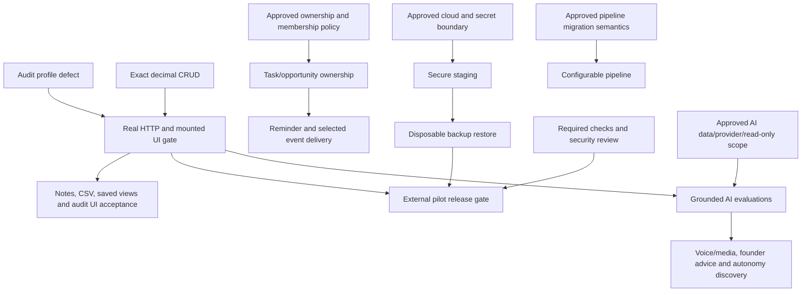

# 48-hour execution plan — sole-developer backlog

This is the Phase 1 planning deliverable, not permission to start major implementation. Based on the audited main SHAs in [implementation-status](./implementation-status.md), [30 original SRS rows](./srs-traceability.md), and the separately classified [vision](./vision-roadmap.md). All work belongs to the sole user/developer; legacy team names do not create cross-developer dependencies.

## Recommended decision

Use the next 48 elapsed hours to remove the two P0 data/persistence defects, establish a reliable integration gate, and close a small number of existing-backend UI gaps. **Full SRS completion and production launch cannot honestly fit this window**: configurable pipelines, secure onboarding/recovery, ownership/reminders and cloud recovery require multiple reviewed designs and substantial implementation. An internal alpha can improve without claiming external-pilot readiness. External pilot remains gated by isolation, secure deployment and demonstrated restore per SRS §14.

Implementation order is P0 security/integration/blocking defects → P1 missing core SRS → P2 usability/reporting/operations → P3 approved grounded AI → P4 voice/multimodal/spatial research. An environment wait does not justify weakening security or counting a blocked test as a pass. Work on independent frontend stories while approved infrastructure access is pending.

## Executable backlog

Each acceptance below is a proposed release test, not an original quoted SRS acceptance criterion. Hours are focused engineering ranges including meaningful tests, excluding decision/access waits. File scopes and dependencies make each item convertible to an issue/PR; no external issues were created in this phase.

### B00 — P0 · Fix profile audit constraint / add DB regression

- **Traceability:** FR-014; profile §5.1; NFR-008.
- **Change scope:** backend identity/audit; new forward Flyway migration; real DB test.
- **Dependency / decision:** None; working disposable PostgreSQL for acceptance; owner reviews migration.
- **Effort:** 2–4h.
- **Acceptance test:** On empty and upgraded DB, own-profile PATCH commits names plus exactly one USER_PROFILE_UPDATED event with correct actor/target; failed audit rolls back; anonymous/missing CSRF rejected.
- **Current state:** Source-confirmed defect; local runtime gate blocked by Docker.

### B02 — P0 · Preserve core opportunity decimal values

- **Traceability:** FR-007; NFR-003/010.
- **Change scope:** umer contracts/forms/api and unified adapter; backend DTO contract only if needed.
- **Dependency / decision:** Approved compatible decimal transport decision; no unapproved new dependency.
- **Effort:** 3–5h.
- **Acceptance test:** Read/edit unrelated field/write 999999999999999.1234 preserves exact NUMERIC(19,4); amount/currency pairing and 0.1/0.2 behavior retained; report reconciles same record.
- **Current state:** Deterministic conversion defect.

### B01 — P0 · Establish release HTTP/browser integration gate

- **Traceability:** FR-001/002/003/005/006/011/012; NFR-002/008.
- **Change scope:** Disposable PostgreSQL runner, backend live tests, mounted web/browser CI fixture.
- **Dependency / decision:** B00,B02; working Docker/CI disposable DB; test-only identities.
- **Effort:** 4–8h.
- **Acceptance test:** Sign in→select tenant→company/contact→opportunity→pipeline→task/activity→notification→logout runs against real HTTP. Two tenants, all roles, revocation/expiry, failed relationships and stale requests pass; no existing accounts mutated.
- **Current state:** Local execution BLOCKED; hosted startup available.

### B03 — P0/P1 · Approve onboarding/recovery and abuse model; then implement

- **Traceability:** FR-002/004; NFR-001.
- **Change scope:** ADR/threat model first; identity/organization/approved channel; web account/admin.
- **Dependency / decision:** Owner selects trusted delivery/identity channel and verifies sender/environment; secret handling review.
- **Effort:** 2–4h decision; 12–20h recovery; 12–20h invites.
- **Acceptance test:** Recovery/invite tokens hashed, expiring, single-use; responses do not enumerate accounts; rate limits tested; invite creates correct tenant/least-privilege role; revoked tokens/accounts denied.
- **Current state:** Security/product decision required; implementation out of Phase 1.

### B11 — P0 · Choose/reproduce secure staging topology and deployed routing

- **Traceability:** FR-018; NFR-001/004/005/012; SRS §§3/12.
- **Change scope:** Deployment ADR and reviewed infrastructure/config; frontend SPA/proxy and backend runtime.
- **Dependency / decision:** Owner cloud/runtime/domain/access/budget decision; B00,B02 before release.
- **Effort:** 8–16h plus access wait.
- **Acceptance test:** Deploy exact FE/BE SHAs; /api failures return API status not index.html; deep links/refresh work; TLS and Secure/HttpOnly/SameSite CSRF sessions accepted; metrics private; secrets external and least privilege.
- **Current state:** No located deployment artifacts; no cloud resources created in audit.

### B12 — P0 · Required review and security/dependency delivery gates

- **Traceability:** NFR-001/007/008; SRS §§12/13/16.
- **Change scope:** Both CI pipelines, dependency/secret scan policy, branch/rules documentation.
- **Dependency / decision:** Owner approval for protected-branch/security settings and scanner choices.
- **Effort:** 3–5h.
- **Acceptance test:** PR cannot merge with failed required checks; review policy verified; scans produce reports/no untriaged critical findings; no secrets printed; browser/DB gates named and versioned.
- **Current state:** Current checks green, scans/rules not verified.

### B14 — P0 · Backup, restore and release recovery evidence

- **Traceability:** NFR-006/012; SRS §14.
- **Change scope:** Approved DB backup/retention/runbook and disposable restore test.
- **Dependency / decision:** B11 environment; owner RPO/RTO/retention/restore-target approval.
- **Effort:** 6–10h plus access wait.
- **Acceptance test:** Restore isolated snapshot, validate migrations/representative tenant counts/integrity; record measured recovery and approved RPO/RTO; deployment rollback/forward migration plan reviewed.
- **Current state:** No backup automation/demonstration found.

### B04 — P1 · Mount dedicated notes on CRM records

- **Traceability:** FR-009; SRS §5.1.
- **Change scope:** web features/notes or owned workflow adapter; existing /api/notes.
- **Dependency / decision:** Existing notes contract E07; B01 for release acceptance.
- **Effort:** 3–5h.
- **Acceptance test:** Company/contact/lead/opportunity own record exposes notes list/create/edit/archive; exactly one parent required; foreign/archived parent denied; VIEWER read only; keyboard errors/empty states work.
- **Current state:** Backend ready; frontend missing.

### B05 — P1 · Integrate entity CSV preview/import/export

- **Traceability:** FR-013; SRS onboarding scope.
- **Change scope:** web features/data-transfer; existing import/export endpoints.
- **Dependency / decision:** E09; OWNER/ADMIN importer; B01 release gate.
- **Effort:** 5–8h.
- **Acceptance test:** Templates for four supported resources; invalid preview shows row errors and makes no writes; confirmed valid import atomic; no automatic retry after ambiguous timeout; export permission/formula safety and 1000-row cap disclosed.
- **Current state:** Backend ready; frontend missing.

### B06 — P1 · Add tenant-safe task and opportunity ownership

- **Traceability:** FR-007/010.
- **Change scope:** backend task/opportunity DTO/entity/service/migrations; scoped eligible-member lookup; web forms.
- **Dependency / decision:** Owner accepts assignee policy and inactive/revoked-owner handling; B00 migration-test pattern.
- **Effort:** 6–10h tasks; 8–12h opportunities.
- **Acceptance test:** Assign/reassign only own active enabled members; foreign/suspended IDs rejected; removal/revocation behavior defined; VIEWER cannot assign; owner filter/label and audit pass; existing rows preserved.
- **Current state:** Missing schema/contracts; not just a UI dropdown.

### B08 — P1 · Configurable tenant pipelines and ordered stages

- **Traceability:** FR-008.
- **Change scope:** backend pipeline/stage model, deal references/migrations, settings/admin UI.
- **Dependency / decision:** Owner approves stage semantics/terminal status mapping and existing-deal migration; B01.
- **Effort:** 18–28h.
- **Acceptance test:** Admin configures/reorders pipeline; stage IDs tenant validated; assigned deals move through permitted stages; deletion of occupied stage denied or explicitly migrated; all current deals retained; rollback/restore documented.
- **Current state:** Large SRS gap, unlikely in committed 48h scope.

### B09 — P1 · Define reminders and selected CRM notification events

- **Traceability:** FR-015; SRS §5.1.
- **Change scope:** task/reminder scheduling/outbox/event policy and notification service; owned UI.
- **Dependency / decision:** B06; approved delivery/scheduler/queue choice and dedupe/cancellation policy.
- **Effort:** 6–10h after decisions.
- **Acceptance test:** Due reminder creates one valid recipient notification; complete/reassign/revoke/tenant switch prevents invalid delivery; restart/retry idempotent; timezone and failure tests; no claim of real-time without mechanism.
- **Current state:** Existing notifications membership-only; no reminder worker.

### B15 — P1 · Mount basic saved views

- **Traceability:** FR-012 supporting §5.1.
- **Change scope:** web saved-view adapter and list filter controls; existing /api/saved-views.
- **Dependency / decision:** E07 version-1 allowlists; B01 release acceptance.
- **Effort:** 3–5h.
- **Acceptance test:** Save/apply/edit/archive named own-tenant resource view; invalid fields rejected server-side; VIEWER reads but cannot modify; company/contact/lead/opportunity/task/activity filters restored visibly.
- **Current state:** Backend ready; frontend missing.

### B07 — P2 · Audit history for organization administrators

- **Traceability:** FR-014 usability.
- **Change scope:** web audit feature; existing paged /api/audit-events.
- **Dependency / decision:** B00; E10; OWNER/ADMIN route guard.
- **Effort:** 3–5h.
- **Acceptance test:** Admin filters/paginates actor/time/event/target/outcome for own tenant; VIEWER/SALES_USER denied; platform-level null-tenant events not silently exposed; safe failure states.
- **Current state:** Backend ready; frontend missing.

### B10 — P2 · Operational UX, accessibility, KPI and performance baseline

- **Traceability:** FR-011/012; NFR-003/009/011.
- **Change scope:** web/core workspaces and collection APIs; acceptance/load docs.
- **Dependency / decision:** B01; owner defines load/SLO/KPI targets.
- **Effort:** 4–8h baseline; 8–14h paging separately.
- **Acceptance test:** Keyboard/zoom/contrast/error/focus paths checked; browser Back/tenant switching prompts on unsaved edits; entity detail/task/activity links usable; measure own synthetic p50/p95/error/query count; lists bounded and currencies exact.
- **Current state:** Current lists unpaged; history/SLO/AA acceptance absent.

### B13 — P2 · Privacy/retention/archive policy

- **Traceability:** FR-017; NFR-010; SRS §14.
- **Change scope:** Versioned data classification/retention/export/deletion runbook; approved APIs only later.
- **Dependency / decision:** Owner legal/product retention/erasure/hold decision; B14 recovery plan.
- **Effort:** 4–8h design; implementation estimate follows decision.
- **Acceptance test:** PII inventory mapped to tables/exports/logs; approved archive/restore/erasure cases tested with audit preservation; no destructive customer purge as a test.
- **Current state:** Policies not found; no automatic restore promise.

### B16 — P2 · Complete versioned API and architecture documentation

- **Traceability:** FR-016; NFR-007; SRS §§10/18.
- **Change scope:** Both repos docs; endpoint/DTO contract checks; ADR supersession.
- **Dependency / decision:** Existing audited controllers E12; owner accepts schema/tool approach.
- **Effort:** 3–5h.
- **Acceptance test:** All endpoints/roles/CSRF/tenant headers/filter limits/status/errors have tested examples; update stale milestone limitations; classify future decisions rather than silently rewriting accepted ADRs.
- **Current state:** Partial prose contracts; no OpenAPI found.

### B17 — P2 · Unify snapshot invalidation and notification refresh

- **Traceability:** FR-011/015; NFR-003.
- **Change scope:** ProductionApplication overview, intelligence ScopedStore, workflow notification mutations.
- **Dependency / decision:** B01; existing shared context/feature contract; cache ownership agreement.
- **Effort:** 2–4h.
- **Acceptance test:** Read/read-all/task/stage action refreshes shell and relevant page from confirmed server state; stale account/tenant results ignored; no duplicate mutation/replay or accidental polling claim.
- **Current state:** Separate page/shell stores can show stale snapshot.

### B18 — P3 · Approve and evaluate grounded read-only AI CRM MVP

- **Traceability:** Vision B/C; not an original completed FR.
- **Change scope:** Owner-approved story/ADR/evals; backend tenant read-only tools and assistant adapter later.
- **Dependency / decision:** B00,B02,B01; provider/data/cost/retention approval; P0 release risks addressed.
- **Effort:** 2–4h discovery/eval design; 12–20h implementation later.
- **Acceptance test:** Only permitted fixture facts cited; absent history causes abstention; cross-tenant/prompt-injection/provider failure tests pass; no writes/email sends; exact currency values preserved and costs bounded.
- **Current state:** AI service absent; preview only.

### B19 — P4 · Voice/multimodal feasibility and consent contract

- **Traceability:** Vision E; proposed extension.
- **Change scope:** Research/design spike, accessible text-equivalent and media contract.
- **Dependency / decision:** Approved B18; capture/provider/retention consent and owner device/use-case decision.
- **Effort:** 3–5h research; implementation scoped later.
- **Acceptance test:** Document capture/stop/delete/tenant upload isolation and text fallback; explicit source provenance; no microphone or file collection enabled in this phase.
- **Current state:** Missing, approval required.

### B20 — P4 · Spatial/VR use-case and read-only interface study

- **Traceability:** Vision F; proposed extension.
- **Change scope:** Decision memo and shared aggregate interface sketch.
- **Dependency / decision:** Validated owner use case, device/accessibility/budget; no architecture replacement.
- **Effort:** 2–4h discovery.
- **Acceptance test:** One measurable CRM benefit and accessible web alternative; same tenant data contract; no fabricated XR deliverable or new parallel datastore.
- **Current state:** Missing, not a 48h build commitment.

### B21 — P3 future · Founder onboarding/advisory discovery

- **Traceability:** Vision D; proposed extension.
- **Change scope:** Product journeys, evidence corpus/consent and advisory boundaries.
- **Dependency / decision:** Owner supplies/approves broader vision source/personas and outcomes.
- **Effort:** 3–5h discovery.
- **Acceptance test:** Approved founder journey distinct from CRM membership onboarding; recommendations backed by supplied sources, editable and human reviewed.
- **Current state:** No attributable vision specification located.

### B22 — P3 future · Autonomous operation governance and dry-run design

- **Traceability:** Vision G; deferred SRS §5.2.
- **Change scope:** Separate ADR/action approval/idempotency/audit/revocation design.
- **Dependency / decision:** B18 acceptance; owner explicitly approves bounded actions/authority; B06/B09 where relevant.
- **Effort:** 4–8h discovery; no executor commitment.
- **Acceptance test:** Dry-run plan cannot act; consequential actions require approval; replay/cancellation/audit/failure recovery defined and tested before any executor.
- **Current state:** No agent tool executor exists.

## 48 elapsed-hour schedule and stop rules

The schedule budgets approximately **30 focused hours plus 18 hours for rest, human review, access waits and contingency**. It is not 48 uninterrupted engineering hours. Pick the low-risk plan below; do not silently add every backlog range. If actual effort exceeds a block, carry the unfinished issue forward rather than accepting incomplete security/data behavior.

| Elapsed window | Focused budget | Work / exit condition                                                                                                                                                                                             |
| -------------- | -------------- | ----------------------------------------------------------------------------------------------------------------------------------------------------------------------------------------------------------------- |
| H0–H6          | 4h             | B00 forward audit migration and profile DB regression; owner migration review; arrange working disposable DB. If DB remains unavailable, prepare reviewed change/test but do not mark acceptance complete.        |
| H6–H12         | 4h             | B02 decimal-safe core round trip and regression; preserve compatible DTO boundaries. If transport design expands, reject unsafe inputs as reviewed temporary mitigation and track full fix.                       |
| H12–H20        | 6h             | B01 real HTTP plus mounted browser core journey/tenant/session acceptance and CI gate; run all existing checks. Inspect B03/B11/B12/B14 decisions without creating cloud resources/security changes on inference. |
| H20–H28        | 4h             | B04 dedicated notes integration using existing API; own-parent validation/read-only/keyboard acceptance.                                                                                                          |
| H28–H36        | 6h             | B05 CSV preview/import/export UI using existing API; validation/atomicity/limits and ambiguous retry states.                                                                                                      |
| H36–H42        | 3h             | B15 saved views if B01/B04/B05 acceptance is green; otherwise use this block to finish their errors/release checks.                                                                                               |
| H42–H48        | 3h             | Full regression, code/PR review and exact release evidence; acceptance report/update backlog. No deployment without B11/B12/B14 conditions.                                                                       |

Committed budget total: 30 focused hours. B04/B05/B15 are conditional: lower bound effort and existing API stability assumed. B06 ownership is the next P1 implementation after the committed slice, **before expanding reminders or AI**; swapping B15 for a task-assignment slice needs explicit owner priority choice and the reviewed membership/migration policy. B08 configurable pipelines and B03 production recovery/invites are major P1 work carried forward, not hidden “later polish.” B07/B10/B13/B16/B17 follow core gaps; P3/P4 discovery happens only with unused time and owner approval. If the owner instead prioritizes external-pilot launch, reallocate feature UI blocks to B03/B11/B12/B14 and expect fewer features delivered.

## Dependency ordering

## Reviewable completion and rollout procedure

For every issue: record scoped source changes, tests and unknowns; use dedicated feature branches; leave existing work intact; check freshly fetched main before integration. Any database change uses a new forward Flyway migration and an existing-data upgrade fixture, with reviewed recovery considerations. Reuse the modular monolith, sole frontend root/context and feature manifests. No new service/framework/library/database/cloud product or security-sensitive policy is approved by this plan alone.

Run frontend root lint/types/tests/format/build/dev checks, backend clean verify, real fixture integration and relevant mounted browser smoke. Record passed/failed/skipped counts and exact SHAs. CI-green alone is insufficient for F01/F02: assertions must cross the real persistence/serialization boundary. Owner reviews meaningful PRs before merge; this phase creates one documentation PR and no auto merges.

A release candidate additionally needs staged HTTPS/cookie/CSRF/SPA/API error checks, all-role/two-tenant adversarial acceptance, backup/restore evidence, safe monitoring/secrets and approved operational limits. Configure no production accounts, invitations, passwords or cloud settings during test setup. Use disposable fixtures; never overwrite an existing customer database to obtain a passing test.

## Phase 1 exit criteria

- Current source/PR/CI snapshots recorded and four requested planning files committed on a dedicated branch.
- FR-001–FR-018 and NFR-001–NFR-012 copied exactly from accessible SRS, scope gaps and proposed tests/dependencies recorded; supporting non-ID scope separately labeled.
- Vision A–G provenance/implementation separated; missing attributable broader vision remains explicit.
- F01/F02 source defects distinguished from runtime reproduction; standard tests and blocked live tests reported without invented passes.
- Major implementation remains untouched; no merges, destructive Git operations, real-record mutations or sensitive settings changes.
