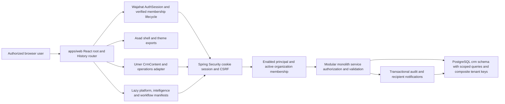

# Implementation status — evidence audit

Audit date: 2026-10-13 (America/Los_Angeles). Phase 1 is documentation only. The user is the sole developer and decision-maker for the next 48 hours. Historical developer names denote reusable source ownership, not staffing or dependencies.

## Executive finding

WAUTECH is a working, integrated internal-alpha CRM codebase with green unit/MVC/build CI, **not a fully SRS-complete or production-accepted product**. Core entity CRUD, shared authentication/membership, fixed pipeline, task/activity operations, current executive reporting and membership administration/notifications are mounted in apps/web. Account recovery, complete onboarding, configurable pipelines, task/opportunity ownership, reminders, notes/saved-view/import/export/audit UI, and production deployment/recovery remain.

The authoritative SRS was located and read in connected Drive: [WAU TECH CRM SRS v0.1](https://docs.google.com/document/d/1t6GuXbof6uZLHirEPNnSyZAKIK7UPHQYR6qnCY37F4k/edit). All **30 identified requirements** are traced verbatim in [srs-traceability](./srs-traceability.md), plus nine labels for non-table scope. Classification: **8 COMPLETE, 19 PARTIAL, 1 MISSING, 2 UNVERIFIED**. These are evidence-based implementation classifications, not percentage-complete estimates or staging acceptance. Approval/sign-off of the located SRS is not evidenced; no later approved version was found.

## Repository snapshot and preservation

| Repository       | Fetched origin/main                        | Local audit checkout / comparison                                                                                                                           | PR snapshot at inspection                                                          |
| ---------------- | ------------------------------------------ | ----------------------------------------------------------------------------------------------------------------------------------------------------------- | ---------------------------------------------------------------------------------- |
| wautech-frontend | `d3c9e3054e15595d1d734b1ff261aa4dd46adf58` | Started clean on feature/sprint3-umer-workflows; created codex/48-hour-architecture-audit from fetched main.                                                | No open PRs. #8/#9/#10/#11 are represented in main history; #11 merged at d3c9e30. |
| wautech-crm      | `9173373f29ac1d3840ed95b81c8d1c1ddb506703` | Preserved feature/sprint3-wajahat-platform at `57bc933075c4ffd1aea5eac2f7fd29a57b7fbeb8`; `git diff --quiet origin/main` returned 0: identical source tree. | No open PRs; main history includes #20 and #21.                                    |

Local tracked/untracked source work was clean at inspection. Fetches, ordinary branch creation, source reads and builds preserve earlier branches/commits. No reset, rebase, force push, database mutation or account provisioning occurred. Maven clean removed only generated backend/target artifacts. This planning PR changes only the four requested documentation files. Backend has no documentation duplicate branch/PR because a single cross-repository audit avoids two inconsistent copies.

## Source evidence catalog

Links pin the audited main revisions. Read corresponding controllers, services, DTOs, repositories and migration files together; domain coverage is not inferred from a README. Test paths use the matching module under backend/src/test/java/com/wautech/crm and frontend src/tests. Reports are context only.

| Evidence                               | Backend source anchor                                                                                                                                                                                                                                                                                     | Frontend source anchor                                                                                                                                                                                   | Additional inspected scope                                                                                                          |
| -------------------------------------- | --------------------------------------------------------------------------------------------------------------------------------------------------------------------------------------------------------------------------------------------------------------------------------------------------------- | -------------------------------------------------------------------------------------------------------------------------------------------------------------------------------------------------------- | ----------------------------------------------------------------------------------------------------------------------------------- |
| E01 · Tenant/RBAC                      | [backend/src/main/java/com/wautech/crm/platform/security/CrmAuthorization.java](https://github.com/WAUTECH-1/wautech-crm/blob/9173373f29ac1d3840ed95b81c8d1c1ddb506703/backend/src/main/java/com/wautech/crm/platform/security/CrmAuthorization.java)                                                     | [apps/web/src/providers/ApplicationProvider.tsx](https://github.com/WAUTECH-1/wautech-frontend/blob/d3c9e3054e15595d1d734b1ff261aa4dd46adf58/apps/web/src/providers/ApplicationProvider.tsx)             | ActiveOrganizationContextFilter; scoped *Repository; V10/V12/V14; tenant and authorization tests.                                   |
| E02 · Identity/session                 | [backend/src/main/java/com/wautech/crm/platform/security/SecurityConfiguration.java](https://github.com/WAUTECH-1/wautech-crm/blob/9173373f29ac1d3840ed95b81c8d1c1ddb506703/backend/src/main/java/com/wautech/crm/platform/security/SecurityConfiguration.java)                                           | [workspaces/wajahat/src/auth/session.ts](https://github.com/WAUTECH-1/wautech-frontend/blob/d3c9e3054e15595d1d734b1ff261aa4dd46adf58/workspaces/wajahat/src/auth/session.ts)                             | AuthenticationController/Service; CurrentUserOrganizationService; ADR-002; auth/session tests.                                      |
| E03 · Administration/profile           | [backend/src/main/java/com/wautech/crm/organization/controller/OrganizationAdministrationController.java](https://github.com/WAUTECH-1/wautech-crm/blob/9173373f29ac1d3840ed95b81c8d1c1ddb506703/backend/src/main/java/com/wautech/crm/organization/controller/OrganizationAdministrationController.java) | [apps/web/src/features/platform/Administration.tsx](https://github.com/WAUTECH-1/wautech-frontend/blob/d3c9e3054e15595d1d734b1ff261aa4dd46adf58/apps/web/src/features/platform/Administration.tsx)       | OrganizationMembershipService, CurrentUserProfileService, Profile/api; corresponding controller/service tests.                      |
| E04 · Company/contact/lead/opportunity | [backend/src/main/java/com/wautech/crm/opportunity/dto/OpportunityRequest.java](https://github.com/WAUTECH-1/wautech-crm/blob/9173373f29ac1d3840ed95b81c8d1c1ddb506703/backend/src/main/java/com/wautech/crm/opportunity/dto/OpportunityRequest.java)                                                     | [workspaces/umer/src/integration.tsx](https://github.com/WAUTECH-1/wautech-frontend/blob/d3c9e3054e15595d1d734b1ff261aa4dd46adf58/workspaces/umer/src/integration.tsx)                                   | Four controller/service/DTO/repository domains; V2–V5/V10; CrmContent/Workspace; CRUD/transitions tests.                            |
| E05 · Pipeline/value                   | [backend/src/main/java/com/wautech/crm/opportunity/entity/OpportunityStage.java](https://github.com/WAUTECH-1/wautech-crm/blob/9173373f29ac1d3840ed95b81c8d1c1ddb506703/backend/src/main/java/com/wautech/crm/opportunity/entity/OpportunityStage.java)                                                   | [workspaces/umer/src/forms.ts](https://github.com/WAUTECH-1/wautech-frontend/blob/d3c9e3054e15595d1d734b1ff261aa4dd46adf58/workspaces/umer/src/forms.ts)                                                 | PipelineController/Service, V5 NUMERIC(19,4); PipelinePage; exact intelligence parser; fixed transitions.                           |
| E06 · Tasks/activities                 | [backend/src/main/java/com/wautech/crm/task/dto/TaskRequest.java](https://github.com/WAUTECH-1/wautech-crm/blob/9173373f29ac1d3840ed95b81c8d1c1ddb506703/backend/src/main/java/com/wautech/crm/task/dto/TaskRequest.java)                                                                                 | [apps/web/src/features/workflows/api.ts](https://github.com/WAUTECH-1/wautech-frontend/blob/d3c9e3054e15595d1d734b1ff261aa4dd46adf58/apps/web/src/features/workflows/api.ts)                             | Task/Activity controllers/services/DTOs/repositories, V6/V7; workflow pages, contracts/tests/browser fixture.                       |
| E07 · Notes/saved views                | [backend/src/main/java/com/wautech/crm/note/dto/NoteRequest.java](https://github.com/WAUTECH-1/wautech-crm/blob/9173373f29ac1d3840ed95b81c8d1c1ddb506703/backend/src/main/java/com/wautech/crm/note/dto/NoteRequest.java)                                                                                 | [apps/web/src/features/registry.ts](https://github.com/WAUTECH-1/wautech-frontend/blob/d3c9e3054e15595d1d734b1ff261aa4dd46adf58/apps/web/src/features/registry.ts)                                       | Note/SavedView controllers/services/repositories/DTOs, V8/V9; no registered feature/consumer found.                                 |
| E08 · Executive summaries/reports      | [backend/src/main/java/com/wautech/crm/pipeline/service/PipelineService.java](https://github.com/WAUTECH-1/wautech-crm/blob/9173373f29ac1d3840ed95b81c8d1c1ddb506703/backend/src/main/java/com/wautech/crm/pipeline/service/PipelineService.java)                                                         | [apps/web/src/features/intelligence/data.ts](https://github.com/WAUTECH-1/wautech-frontend/blob/d3c9e3054e15595d1d734b1ff261aa4dd46adf58/apps/web/src/features/intelligence/data.ts)                     | DashboardPage, ReportsPage, money.ts/csv.ts/runtime, intelligence tests; authorized current state only.                             |
| E09 · CSV data transfer                | [backend/src/main/java/com/wautech/crm/datatransfer/DataTransferController.java](https://github.com/WAUTECH-1/wautech-crm/blob/9173373f29ac1d3840ed95b81c8d1c1ddb506703/backend/src/main/java/com/wautech/crm/datatransfer/DataTransferController.java)                                                   | [apps/web/src/features/intelligence/csv.ts](https://github.com/WAUTECH-1/wautech-frontend/blob/d3c9e3054e15595d1d734b1ff261aa4dd46adf58/apps/web/src/features/intelligence/csv.ts)                       | CsvImportParser, DataTransferService, ResourceType and parser/security/service tests; report CSV is not entity export integration.  |
| E10 · Audit and profile mismatch       | [backend/src/main/resources/db/migration/V17__add_data_transfer_audit_events.sql](https://github.com/WAUTECH-1/wautech-crm/blob/9173373f29ac1d3840ed95b81c8d1c1ddb506703/backend/src/main/resources/db/migration/V17__add_data_transfer_audit_events.sql)                                                 | [apps/web/src/features/platform/Profile.tsx](https://github.com/WAUTECH-1/wautech-frontend/blob/d3c9e3054e15595d1d734b1ff261aa4dd46adf58/apps/web/src/features/platform/Profile.tsx)                     | AuditMutationAspect/Writer/QueryService, CurrentUserProfileService USER_PROFILE_UPDATED; V15/V17; no audit UI.                      |
| E11 · Notifications                    | [backend/src/main/java/com/wautech/crm/notification/service/NotificationEventWriter.java](https://github.com/WAUTECH-1/wautech-crm/blob/9173373f29ac1d3840ed95b81c8d1c1ddb506703/backend/src/main/java/com/wautech/crm/notification/service/NotificationEventWriter.java)                                 | [apps/web/src/features/workflows/NotificationPage.tsx](https://github.com/WAUTECH-1/wautech-frontend/blob/d3c9e3054e15595d1d734b1ff261aa4dd46adf58/apps/web/src/features/workflows/NotificationPage.tsx) | Notification recipient repository/controller/service/DTOs; V16; membership events only; read/count/security tests.                  |
| E12 · API contracts                    | [backend/src/main/java/com/wautech/crm/platform/error/ApiExceptionHandler.java](https://github.com/WAUTECH-1/wautech-crm/blob/9173373f29ac1d3840ed95b81c8d1c1ddb506703/backend/src/main/java/com/wautech/crm/platform/error/ApiExceptionHandler.java)                                                     | [apps/web/src/integrations/http.ts](https://github.com/WAUTECH-1/wautech-frontend/blob/d3c9e3054e15595d1d734b1ff261aa4dd46adf58/apps/web/src/integrations/http.ts)                                       | All controller mappings, handwritten DTO adapters; no OpenAPI schema or full API catalog located.                                   |
| E13 · Operations/deployment            | [backend/src/main/resources/application.yml](https://github.com/WAUTECH-1/wautech-crm/blob/9173373f29ac1d3840ed95b81c8d1c1ddb506703/backend/src/main/resources/application.yml)                                                                                                                           | [apps/web/vite.config.ts](https://github.com/WAUTECH-1/wautech-frontend/blob/d3c9e3054e15595d1d734b1ff261aa4dd46adf58/apps/web/vite.config.ts)                                                           | Health/readiness/ops controllers; MonitoringSecurityConfiguration; compose.yaml; operational docs; no AWS IaC found.                |
| E14 · Builds/CI/architecture           | [backend/pom.xml](https://github.com/WAUTECH-1/wautech-crm/blob/9173373f29ac1d3840ed95b81c8d1c1ddb506703/backend/pom.xml)                                                                                                                                                                                 | [.github/workflows/frontend-ci.yml](https://github.com/WAUTECH-1/wautech-frontend/blob/d3c9e3054e15595d1d734b1ff261aa4dd46adf58/.github/workflows/frontend-ci.yml)                                       | backend-ci.yml; wrappers; ADR-001/002/003; frontend package/lockfile; scripts/verify-dev; 17 Flyway migrations.                     |
| E15 · Shell/routing/accessibility      | [backend/src/test/java/com/wautech/crm/integration/UnifiedFrontendLiveTest.java](https://github.com/WAUTECH-1/wautech-crm/blob/9173373f29ac1d3840ed95b81c8d1c1ddb506703/backend/src/test/java/com/wautech/crm/integration/UnifiedFrontendLiveTest.java)                                                   | [apps/web/src/components/ProductionApplication.tsx](https://github.com/WAUTECH-1/wautech-frontend/blob/d3c9e3054e15595d1d734b1ff261aa4dd46adf58/apps/web/src/components/ProductionApplication.tsx)       | DashboardApplication, routing/history, FeatureView, workflow Confirmation, platform useUnsaved, Umer Dialog; browser smoke scripts. |

## Architecture as implemented

Frontend: Node 24.19.0 requirement, npm 11.6.2, React 19.3.0, TypeScript 5.9.3, Vite 8.3.4, Tailwind Vite integration, ESLint/Prettier/Vitest; root workspaces and lockfile. One production root/router/session; three standalone workspaces remain development/demo surfaces. API base URL comes from VITE_API_BASE_URL; local /api proxy uses WAUTECH_DEV_API_TARGET. No second SPA is mounted in production.

Backend: Java 25, Spring Boot 3.5.16, Maven Wrapper (local Maven 3.9.11), JPA, PostgreSQL 17, Flyway, Spring Security session/CSRF, optional OAuth2 JWT monitoring, Commons CSV 1.11.0 and Micrometer Prometheus. 177 main and 60 test Java files compiled in this run. Domains: company/contact/lead/opportunity, fixed pipeline, activity/task/note/savedview, identity/organization, audit/notification/datatransfer plus platform security/tenant/error/search/health. These are a modular monolith, not separate services.

V1–V17 cover foundation, seven CRM/saved-view tables, tenant ownership, users/memberships/password/roles, audit, notifications and transfer audit additions. V10 adds non-null organization IDs, tenant-leading indexes and composite parent keys; legacy data is assigned to a generated legacy organization. V14 defaults migrated membership roles to VIEWER. No configurable pipeline/stage tables, task/opportunity owner columns, reminder/job tables or AI persistence were found. PostgreSQL relationships supplement service tenant checks; JPA schema generation is validate-only.

ADRs: ADR-001 accepts the backend stack/modular monolith; ADR-002 accepts browser sessions/CSRF/same-origin and explicitly limits default sessions to one instance; ADR-003 accepts OWNER/ADMIN/SALES_USER/VIEWER and owner protections. No accepted AWS runtime/IaC/email/job/AI decision was found. This audit proposes decisions for approval; it does not approve new frameworks, cloud resources or security-sensitive architecture.

## Integration and route audit

| Area / route                                  | Current integrated behavior                                                                                                                                          | Remaining evidence or functionality                                                                                                                                              |
| --------------------------------------------- | -------------------------------------------------------------------------------------------------------------------------------------------------------------------- | -------------------------------------------------------------------------------------------------------------------------------------------------------------------------------- |
| /login; /organizations                        | Shared session restore/login/logout; caller-only ACTIVE memberships; selected membership revalidated; account/tenant generations isolate requests.                   | Recovery/invite acceptance missing; real deployed cookie/proxy/CSRF acceptance absent.                                                                                           |
| /companies; /contacts; /leads; /opportunities | Umer CrmContent controls four full CRUD/archive screens with relationships, search/sort, lead status/opportunity stage transitions; VIEWER controls disabled.        | Core amounts use JS Number; record details are local UI state rather than stable entity detail URLs; no owner selector.                                                          |
| /dashboard                                    | New intelligence manifest replaces legacy core route; authorized current pipeline/task/activity/lead/company/contact summaries and per-source failures.              | No history/revenue/forecast claim; pilot reconciliation and bounded aggregate collection strategy.                                                                               |
| /pipeline; /reports                           | Fixed-stage pipeline, backend-confirmed moves, exact decimal currency-separated summaries; reports provide lead creation-cohort filtering and authorized report CSV. | Pipeline admin configuration missing; report CSV does not substitute for entity CSV import/export.                                                                               |
| /tasks; /activities                           | Workflow manifest replaces future placeholders; CRUD/archive/status/dates, filters, own query-detail and relationship links, manual refresh.                         | Assignment, reminder delivery and activity attribution absent; parent entity detail screens have no embedded task/activity entry yet.                                            |
| /notifications                                | Recipient-scoped server pages, unread/read/read-all, target verification; membership administration link only when authorized.                                       | Event set is activation/role changes only; no real-time infrastructure. Page count refresh does not automatically invalidate the legacy shell's separately loaded bell snapshot. |
| /administration                               | OWNER/ADMIN current organization rename, existing-user membership list/create/status/role actions.                                                                   | New user invitation/recovery delivery, user discovery and ownership-transfer HTTP/UI missing. Last-owner protections exist in service.                                           |
| /profile; /account                            | Self-profile names; organization switch, themes and logout; explicit unavailable security options.                                                                   | Profile persistence defect described below; passwords/MFA/verification unavailable.                                                                                              |
| /settings                                     | Existing shell device-local theme selection.                                                                                                                         | This is not pipeline/admin configuration or server notification preferences.                                                                                                     |
| /unauthorized; /access-denied; unknown        | Guarded status/error/404 views. Root resolves to dashboard.                                                                                                          | Deployed SPA fallback must exclude API errors; not evidenced by Vite dev routing.                                                                                                |
| /feature-example                              | Tenant-protected example manifest, no nav entry.                                                                                                                     | Decide whether to ship example in production during release cleanup.                                                                                                             |
| Notes/saved views/imports/exports/audit       | Backend endpoints and tests exist; no consumer/feature route for these domains found in apps/web or reusable workspaces.                                             | Add owned adapters/UI rather than a parallel app or store.                                                                                                                       |
| Assistant / AI                                | Shell states AI service is not connected and disables submission; no backend AI controller/provider client/LLM retrieval tools found.                                | A preview is not AI functionality; P3 needs explicit approved product/data boundary and evaluations.                                                                             |

Feature registry discovers features/*/feature.ts eagerly and lazy-loads pages; existing paths are replaced through the contract. Role navigation and direct URL access share route guards. Session-only profile/account/organization selection mount without requiring a selected tenant. Backend roles remain authoritative. Authentication endpoints omit tenant headers, CRM calls add the validated tenant, mutations fetch CSRF, 401 invalidates session, and 403 remains an operation/tenant error. DTOs enforce links/limits/enums; backend generic ProblemDetail handling and frontend safe errors are implemented. No bypass was identified in the reviewed tenant paths; this is bounded inspection, not a penetration-test certificate.

## Release-blocking findings

### F01 — profile audit event / database constraint mismatch (P0)

CurrentUserProfileService.update emits `USER_PROFILE_UPDATED` through AuditMutationAspect, which writes the audit in the same transaction. V17 replaces audit_event_event_type_check with an allowlist that excludes this event; no later migration exists. A static comparison of every @AuditedMutation event to the final constraint produced exactly this missing event. On a correctly migrated PostgreSQL database the audit insert is expected to violate the CHECK and roll back profile saving. **Source-confirmed mismatch; real PostgreSQL reproduction is blocked locally**, so no actual customer failure is claimed.

Acceptance: add a new forward migration (do not edit applied V17), execute migrations from empty and existing schemas, PATCH the principal's profile through real HTTP, and verify exactly one audit event with correct actor/target and atomic commit. Do not weaken audit or skip it. Existing CurrentUserProfileControllerTest mocks the profile service, and the profile service unit test uses mocked persistence; the baseline green result does not refute the mismatch.

### F02 — opportunity decimal loss in core CRUD path (P0)

V5 stores NUMERIC(19,4); OpportunityRequest uses BigDecimal. The integrated Umer forms.toRequest converts amount text with Number(value), and its contracts/API use ordinary JSON numeric reads. A direct runtime check yields `Number('999999999999999.1234').toString() === '999999999999999.1'`. This is a supported database-sized amount; an unrelated core edit may write a rounded value. Intelligence reports have a separate exact-token parser, which does not repair the core editing path. **Deterministic conversion defect; database round-trip acceptance not performed**. Use a documented decimal string contract/compatible parsing or reject non-round-trippable values until a reviewed solution is implemented; do not introduce a financial library silently.

### F03 — release integration and deployment gap (P0)

Standard tests use mock persistence extensively, browser fixtures are explicitly in-memory, and four isolated live HTTP tests are opt-in. Docker failed before creating the fixture with “Docker Desktop is unable to start.” Fresh migration/startup succeeds in hosted backend CI, but CI does not PATCH profiles or run the mounted React application. No AWS application runtime/IaC, versioned deployment promotion, backup automation/restore evidence or deployed TLS/cookie/fallback validation was found. Production and external-pilot readiness remain UNVERIFIED; fix F01/F02 and establish these gates before claiming launch readiness.

## Reusable workspace audit

| Workspace | Production reuse verified in source                                                                                                    | Retained unintegrated/demo surfaces                                                                                                                                                           |
| --------- | -------------------------------------------------------------------------------------------------------------------------------------- | --------------------------------------------------------------------------------------------------------------------------------------------------------------------------------------------- |
| Wajahat   | Package auth index/AuthProvider/AuthSession, LoginPage and Brand are imported by apps/web; platform feature extends that sole context. | Standalone App/Portal/status routes are not a second production router. Manual organization flows and old “missing API” notes are historical. No hidden recovery/invite implementation found. |
| Umer      | CrmContent→Workspace, forms/tables/dialogs/contracts/CrmOperations are mounted under web adapters.                                     | Standalone login/sidebar/manual UUID and live-smoke script remain development-only. There is no dormant notes/saved-view/import UI to integrate. Numeric opportunity forms need F02.          |
| Asad      | DashboardApplication/Card/theme/shell/widget exports reused; intelligence feature mounts new content within host.                      | Demo fixtures, performance history charts and preview directory remain standalone/demo; local assistant draft has no AI service. No voice/VR/founder-agent implementation found.              |

Do not delete these workspaces for this phase. Reuse host-safe exports; future features live under apps/web/features and share the existing context/transport. Do not treat marketing visuals or demo conversations/history as business evidence.

## Baseline verification — actual rerun

| Check                                 | Result at audited source                                                                                                                                                                                                                       |
| ------------------------------------- | ---------------------------------------------------------------------------------------------------------------------------------------------------------------------------------------------------------------------------------------------- |
| Frontend root ESLint                  | PASS, max-warnings=0; no reported warnings                                                                                                                                                                                                     |
| TypeScript                            | PASS in web/asad/umer/wajahat                                                                                                                                                                                                                  |
| Vitest                                | 226 passed, 0 failed, 0 skipped: web 151 (12 files), asad 10 (2), umer 29 (4), wajahat 36 (6)                                                                                                                                                  |
| Builds                                | All four production Vite builds PASS; web 103 modules, main JS approximately 295.75 kB / 90.17 kB gzip                                                                                                                                         |
| Prettier repository                   | PASS before documentation; requested docs checked again before commit                                                                                                                                                                          |
| verify:dev                            | PASS all four dev entrypoints/strict duplicate-port rejection (5173–5176); servers cleaned up                                                                                                                                                  |
| Backend clean verify                  | BUILD SUCCESS; 55 Surefire suites, 360 total, **356 passed, 0 failures, 0 errors, 4 skipped**; packaged executable jar                                                                                                                         |
| Backend runtime/compiler warnings     | Maven Guice terminally deprecated Unsafe; Mockito/ByteBuddy dynamic agent/CDS warnings; deprecated API in SavedViewConfigurationValidator and DataTransferServiceTest; unchecked OrganizationServiceTest. No test failure from these warnings. |
| Local isolated HTTP/PostgreSQL runner | BLOCKED before fixture creation: Docker Desktop unable to start. Four UnifiedFrontendLiveTest tests remain skipped, not counted as passes. No existing DB volume/account touched.                                                              |
| Hosted frontend main CI               | [Run 38470884636](https://github.com/WAUTECH-1/wautech-frontend/actions/runs/38470884636), success at d3c9e305; install/lint/types/tests/format/build pipeline.                                                                                |
| Hosted backend main CI                | [Run 38425171508](https://github.com/WAUTECH-1/wautech-crm/actions/runs/38425171508), verify job success at 9173373; complete Maven verification and packaged app/PostgreSQL migration/readiness smoke both succeeded.                         |

This environment lacks npm on the default PATH; the installed Node 24.19.0 executed the same repository ESLint/tsc/Vitest/Vite/Prettier scripts directly, with no dependency/lockfile changes. Maven used JAVA_HOME for JDK 25.0.4.1 and the repository wrapper. Reproduction: configured environment `npm run check`, `npm run verify:dev`; backend `mvnw.cmd --batch-mode clean verify`; live `scripts/Test-UnifiedIntegration.ps1` with a working Docker daemon. The workflow-run helper filters PR events, so main push CI was checked via the Actions runs collection plus exact-SHA job steps, not an empty helper result.

Browser audit reruns on current source: **46 assertions passed**: workflow 17, intelligence 13, administration 16. Administration's profile save passes its mocked fixture and does not exercise the PostgreSQL audit constraint. These fixture checks validate rendered interactions, role navigation, tenant clearing and keyboard behavior; they do not establish real backend mutation or production acceptance. No code was edited to make smoke runners pass.

## Documentation conflicts resolved by current evidence

Backend README/ARCHITECTURE/AGENTS milestone still says foundation/no CRM, contradicted by the 177 compiled main source files. ADR-003's “no admin HTTP/audit module” limitations are superseded by OrganizationAdministrationController and audit source, while platform-admin deferral remains true. FR-010-task-assignment-gap says identity foundation is missing; identity/membership now exists, assignment still does not. Frontend sprint/unified/feature-contract reports still say #20/#21 or #8 dependencies unmerged and workflow authoring unavailable; current fetched main contains those implementations. Treat these as historical reports at their original dates. This status document supersedes their “current state” claims without deleting their history.

Read Sprint 1 reports/READMEs in all workspaces, Asad/Wajahat Sprint 2 reports/integration contracts, web integration/SPRINT-REPORT and Sprint 3 platform/intelligence/workflow delivery reports. Their prior counts and smoke claims were not reused as this audit's test proof.

## Boundaries of confidence

GitHub ruleset collections returned empty arrays for both repositories. Legacy main branch-protection reads returned 403 “Resource not accessible by integration”; therefore required review/status-check enforcement remains UNVERIFIED, not proven absent. Deployment collection reads were unsupported by the available connector; no live deployment inventory was verified. These access limits did not prevent source/SRS inspection, standard verification or this documentation deliverable.

No current staging/production URL, deployment inventory, accepted RPO/RTO/SLO, approved Asad vision source or private security policy was supplied/found. GitHub branch protection/required human review is not proven by successful checks; administrative connector reads may be unavailable. No dependency vulnerability/secret scan gate exists in the inspected pipelines, and this audit does not claim a clean vulnerability scan. SRS comparison is accessible and complete for identified rows; a newer SRS or missing broader vision can change the backlog through versioned owner review. AI, voice, founder advice and spatial/autonomous operations are scoped separately in [vision-roadmap](./vision-roadmap.md).
